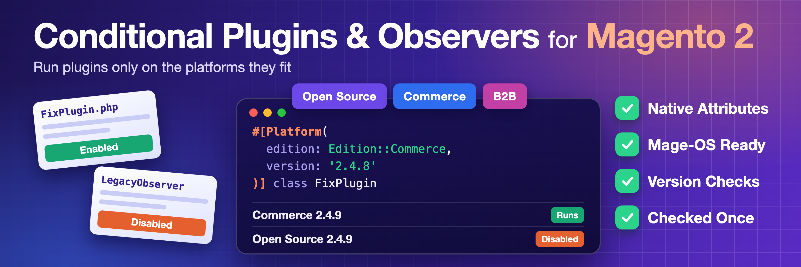

# Conditional Plugins & Observers for Magento 2



[](https://github.com/FriendsOfMagento/module-conditional-plugins/actions/workflows/coding-standard.yml)
[](https://github.com/FriendsOfMagento/module-conditional-plugins/actions/workflows/mess-detector.yml)
[](https://github.com/FriendsOfMagento/module-conditional-plugins/actions/workflows/phpstan.yml)
[](https://github.com/FriendsOfMagento/module-conditional-plugins/actions/workflows/php-compatibility.yml)
[](https://github.com/FriendsOfMagento/module-conditional-plugins/actions/workflows/unit-tests.yml)

Extension vendors ship one release to many stores, running different Magento versions and editions. When a [plugin](https://developer.adobe.com/commerce/php/development/components/plugins/) or an [observer](https://developer.adobe.com/commerce/php/development/components/events-and-observers/) is only needed on some of them, the usual fix is to inject `ProductMetadataInterface` and add an `if` on the edition and version. Those checks repeat across the code, hide what the class is really for and run on every call, and the class is still instantiated and still sits in every stack trace on stores where it has nothing to do.

With this module developers declare where a plugin or observer applies with a native PHP attribute on the class. Magento checks the condition while it builds its configuration and marks a class that does not fit the current platform as disabled, so it is never instantiated and never appears in a stack trace. The code stays free of version checks, and one release can serve every platform the vendor supports.

```php
#[Platform(version: '2.4.8', comparison: Comparison::LessThan)]
class FixFixedInMagento248Observer implements ObserverInterface
```

## Compatibility

- **Magento Open Source / Adobe Commerce:** 2.4.7 or later, tested on 2.4.7-p10, 2.4.8-p5 and 2.4.9, and on Adobe Commerce B2B with 2.4.9
- **Mage-OS:** 3.x and 4.x, tested on 3.6.0 and 4.0.0
- **PHP:** 8.1 or later, tested on 8.1 to 8.5

Other versions aren't tested.

## Installation

```bash
composer require fom/module-conditional-plugins
bin/magento module:enable Fom_ConditionalPlugins
bin/magento setup:upgrade
bin/magento cache:flush
```

## Usage

Add one or more `Platform` attributes to a plugin or observer class. The class runs only when the current platform fits them.

```php
<?php

declare(strict_types=1);

namespace Vendor\Module\Observer;

use Fom\ConditionalPlugins\Attribute\Platform;
use Fom\ConditionalPlugins\Enum\Edition;
use Magento\Framework\Event\Observer;
use Magento\Framework\Event\ObserverInterface;

#[Platform(edition: Edition::Community, version: '2.4.8')]
class SomeKindOfActionObserver implements ObserverInterface
{
    public function execute(Observer $observer): void
    {
        // ...
    }
}
```

A class without a `Platform` attribute always runs.

The attributes are read while the configuration is built, so run `bin/magento cache:flush` after changing one, and `bin/magento setup:di:compile` too in production mode.

### Platform

[`Fom\ConditionalPlugins\Attribute\Platform`](Attribute/Platform.php) describes one condition. It can be added to a class several times.

| Parameter | Type | Default | Compared with |
|---|---|---|---|
| `edition` | [`Edition`](Enum/Edition.php) | `Edition::Any` | the edition the platform reports |
| `version` | `string` | none | the Magento version, such as `2.4.7-p10` |
| `comparison` | [`Comparison`](Enum/Comparison.php) | `Comparison::GreaterThanOrEqual` | how both versions are compared |
| `distribution` | [`Distribution`](Enum/Distribution.php) | `Distribution::Any` | who ships the platform |
| `distributionVersion` | `string` | none | the Mage-OS version, such as `4.0.0` |

Versions are compared with [`version_compare()`](https://www.php.net/manual/en/function.version-compare.php).

An empty version, or a `distributionVersion` without `Distribution::MageOs`, throws `InvalidArgumentException` while the configuration is built.

#### Editions

| Case | Fits |
|---|---|
| `Edition::Any` | every platform |
| `Edition::Community` | Magento Open Source and Mage-OS |
| `Edition::Commerce` | Adobe Commerce without B2B |
| `Edition::B2b` | Adobe Commerce with B2B |

Installing the B2B extension changes the edition the platform reports, so `Edition::Commerce` does not fit a store with B2B. Use [`LogicalOperator::Or`](#operator) to target both.

#### Distributions

| Case | Fits |
|---|---|
| `Distribution::Any` | every platform |
| `Distribution::Magento` | Magento Open Source and Adobe Commerce, but not Mage-OS |
| `Distribution::MageOs` | Mage-OS only |

#### Comparisons

| Case | Operator |
|---|---|
| `Comparison::LessThan` | `<` |
| `Comparison::LessThanOrEqual` | `<=` |
| `Comparison::GreaterThan` | `>` |
| `Comparison::GreaterThanOrEqual` | `>=` |
| `Comparison::Equal` | `=` |
| `Comparison::NotEqual` | `!=` |

### Operator

[`Fom\ConditionalPlugins\Attribute\Operator`](Attribute/Operator.php) sets how several `Platform` attributes are combined. It is optional and can be added to a class once.

| Case | The class runs when |
|---|---|
| `LogicalOperator::And` (default) | every condition fits |
| `LogicalOperator::Or` | at least one condition fits |

### Mage-OS

Mage-OS reports itself to extensions as Magento Open Source, with the version of the Magento release it is based on. Mage-OS 3.6.0 and 4.0.0 are both based on Magento 2.4.9, so a Community 2.4.9 condition fits them too. Use `distribution` when Mage-OS needs different behavior.

| Condition | Magento 2.4.9 | Mage-OS 3.6.0 | Mage-OS 4.0.0 |
|---|---|---|---|
| `Platform(edition: Edition::Community, version: '2.4.9')` | runs | runs | runs |
| `Platform(edition: Edition::Community, version: '2.4.9', distribution: Distribution::Magento)` | runs | off | off |
| `Platform(distribution: Distribution::MageOs)` | off | runs | runs |
| `Platform(distribution: Distribution::MageOs, distributionVersion: '4.0.0')` | off | off | runs |

## Examples

The examples show observers. Plugins are declared the same way.

Run only below a version, on any edition:

```php
#[Platform(version: '2.4.8', comparison: Comparison::LessThan)]
class SomeKindOfActionObserver implements ObserverInterface
```

Run on a range of versions. Both conditions must fit, because `LogicalOperator::And` is the default:

```php
#[Platform(version: '2.4.7')]
#[Platform(version: '2.4.9', comparison: Comparison::LessThan)]
class SomeKindOfActionObserver implements ObserverInterface
```

Run on Adobe Commerce with or without B2B:

```php
#[Platform(edition: Edition::Commerce)]
#[Platform(edition: Edition::B2b)]
#[Operator(LogicalOperator::Or)]
class SomeKindOfActionObserver implements ObserverInterface
```

Run everywhere except Mage-OS:

```php
#[Platform(distribution: Distribution::Magento)]
class SomeKindOfActionObserver implements ObserverInterface
```

Run only on Mage-OS 4.0.0 based on Magento 2.4.9:

```php
#[Platform(
    edition: Edition::Community,
    version: '2.4.9',
    comparison: Comparison::Equal,
    distribution: Distribution::MageOs,
    distributionVersion: '4.0.0'
)]
class SomeKindOfActionObserver implements ObserverInterface
```

Keep Community 2.4.9 and later, but disable on Mage-OS 4.0.0 and later:

```php
#[Platform(edition: Edition::Community, version: '2.4.9', distribution: Distribution::Magento)]
#[Platform(distribution: Distribution::MageOs, distributionVersion: '4.0.0', comparison: Comparison::LessThan)]
#[Operator(LogicalOperator::Or)]
class SomeKindOfActionObserver implements ObserverInterface
```

## How it works

- A preference on `Magento\Framework\ObjectManager\Config\Reader\Dom` marks plugins as disabled when `di.xml` is read.
- A plugin on `Magento\Framework\Event\Config\Converter` marks observers as disabled when `events.xml` is read.
- Conditions are checked only while the configuration is built. The result is stored with the configuration in the cache and in compiled code.

## Limitations

- A class has to load before its attributes can be read, so a plugin or observer can't extend or implement a type that is missing on the current platform.
- A class is still compiled on every platform, so its constructor can't depend on a class that is missing on the current platform. `setup:di:compile` fails on such a class even when the attribute disables it. Keep that code in a separate module that requires the missing package.
- Attributes are read from the class itself. A child class does not inherit the attributes of its parent.
- Only plugins and observers are supported.

## License

[Open Software License 3.0](LICENSE.txt)
